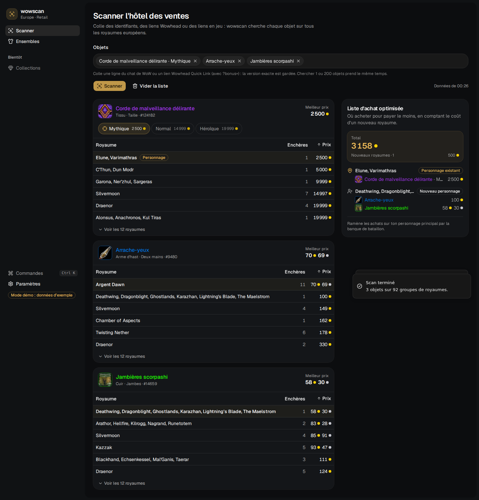
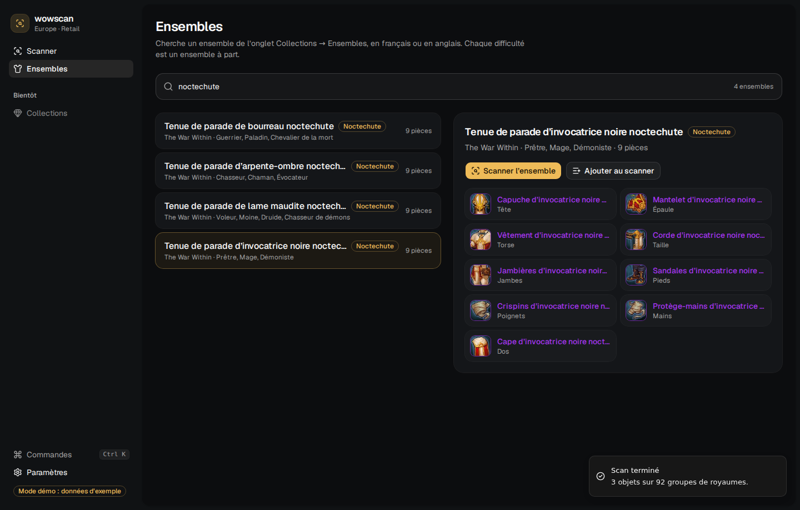

# wowscan

Application desktop (Windows) pour **World of Warcraft Retail, région Europe** : cherche un ou plusieurs objets sur l'hôtel des ventes de **tous les royaumes européens** et calcule la liste d'achat la moins chère. Pensée d'abord pour la transmogrification.

Interface en français et en anglais.



## Ce que fait la version actuelle

- **Versions exactes** : un même objet existe en Normal, Héroïque, Mythique… avec des apparences différentes. wowscan les sépare grâce aux tables du jeu et garde la version demandée (`?bonus=` d'un lien Wowhead, bonus d'un lien en jeu). Sans version précisée, toutes les versions sont proposées et une préférence (*Paramètres → Version par défaut*) choisit laquelle présélectionner.
- **Collections** : l'addon WowScan (dossier `addon/`, installé depuis l'app) exporte en jeu les apparences déjà débloquées du compte. L'app compare avec tous les ensembles, par emplacement comme le jeu, filtre par classe de tes personnages, extension et avancement, et dit pour chaque pièce manquante d'où elle vient (butin de boss avec le boss et l'instance, marchand, quête, métier…). Un clic scanne les pièces manquantes : coût total, pièces en vente et meilleur royaume pour chacune. Le jeu n'écrit l'export qu'au `/reload` ou à la déconnexion.
- **Ensembles** : recherche par nom (français ou anglais) d'un ensemble de l'onglet *Collections → Ensembles*. Chaque pièce est cherchée par son apparence : n'importe quel objet qui la donne convient, la liste d'achat prend le moins cher.
- **Copier-coller depuis le jeu** : une ligne du chat collée dans la liste (ou n'importe où sur la page) est lue ; horodatage, canal et joueur sont ignorés. Le jeu ne copie que `[Nom]`, sans la version : les noms sont retrouvés par la recherche de l'API et toutes leurs versions proposées. Pour garder la version exacte, utilise [ce fork de Wowhead Quick Link](https://github.com/HussonAxel/wowhead-quick-link) : survole un objet, Ctrl+C, et le lien copié contient ses bonus.
- **Scan à la demande** : colle des identifiants d'objets, des liens Wowhead ou des liens en jeu. Chercher 1 ou 200 objets prend le même temps : le coût vient du téléchargement des enchères des ~90 groupes de royaumes, pas du nombre d'objets.
- **Cache horaire** : Blizzard publie un instantané par heure. Un nouveau scan dans l'heure ne retélécharge rien (requête `If-Modified-Since`, réponse `304`).
- **Objets empilables détectés** : herbes, minerais, gemmes… ont un marché unique pour toute la région ; l'app l'indique au lieu de comparer des royaumes.
- **Liste d'achat optimisée** : tu coches les royaumes où tu as déjà un personnage et tu fixes ce que « vaut » un nouveau royaume, en or. L'app choisit où acheter pour minimiser le total. Les achats se ramènent ensuite par la banque de bataillon.
- **Identifiants protégés** : ils sont rangés dans le Gestionnaire d'identification de Windows, jamais dans un fichier.

## Démarrer (Windows)

Prérequis : [Rust](https://rustup.rs) (avec les *Build Tools* MSVC proposés par l'installateur), [Node.js 24](https://nodejs.org) et pnpm (`npm install -g pnpm`). WebView2 est déjà présent sur Windows 10/11.

```powershell
git clone https://github.com/HussonAxel/wowscan.git
cd wowscan/app
pnpm install
pnpm tauri dev      # lance l'app en mode développement
pnpm tauri build    # produit l'installateur dans target/release/bundle/
```

Chaque push sur `main` produit aussi l'installateur Windows dans l'onglet **Actions** de GitHub (artefact `wowscan-windows`).

### Mises à jour

À partir de la 0.2.0, l'app vérifie au lancement s'il existe une nouvelle version, puis la télécharge, l'installe et redémarre en un clic. On peut aussi le faire depuis *Paramètres → Mises à jour*. Les installateurs sont signés, et l'app refuse ceux dont la signature ne correspond pas à la clé publique de `tauri.conf.json`.

Publier une version :

1. Mettre le même numéro dans `app/src-tauri/tauri.conf.json`, `app/package.json` et `Cargo.toml` (`workspace.package`).
2. Pousser un tag `vX.Y.Z` (`git tag v0.3.0 && git push origin v0.3.0`). Le workflow `release.yml` construit l'installateur signé et publie la release GitHub avec `latest.json`, le fichier que les apps installées consultent.

Le workflow a besoin du secret `TAURI_SIGNING_PRIVATE_KEY`, qui contient la clé privée générée par `pnpm tauri signer generate`. Si cette clé est perdue, les apps déjà installées ne pourront plus se mettre à jour.

### Identifiants Blizzard (gratuits, 2 minutes)

1. Va sur <https://develop.battle.net/access/clients> et connecte-toi avec ton compte Battle.net.
2. **Create client** : nom libre (par ex. `wowscan`). Les champs d'URL (redirection, service) ne servent pas pour l'instant.
3. Copie le **Client ID** et le **Client secret** dans *Paramètres → API Blizzard* : l'app les vérifie auprès de Blizzard avant de les enregistrer.



## Travailler sur l'interface sans Windows

`pnpm dev` dans `app/` sert l'interface dans un navigateur avec des **données de démo** : un extrait d'un vrai scan (objets, ensembles, prix du 30/10/2026). Aucun identifiant n'est nécessaire. Pour les régénérer : `app/scripts/demo-data.py`.

## Ligne de commande

Le moteur s'utilise aussi sans interface, sur n'importe quel système :

```bash
export WOWSCAN_CLIENT_ID=... WOWSCAN_CLIENT_SECRET=...
cargo run -p wowscan-cli -- check
cargo run -p wowscan-cli -- realms
cargo run -p wowscan-cli -- scan "https://www.wowhead.com/item=124182?bonus=9081" 9480 --owned 1315 --new-realm-cost 500
cargo run -p wowscan-cli -- scan "[2. Commerce] [Arthas]: VDS [Arrache-yeux]"   # ligne de chat copiée
cargo run -p wowscan-cli -- sets défunts élus
```

## Architecture

```
crates/core/     moteur Rust : client API Blizzard, enchères, cache, fiches d'objets, optimisation
crates/cli/      `wowscan` en ligne de commande
app/             interface React (TanStack Router/Query/Table, Tailwind, shadcn + uiarc, beui, kobra)
app/src-tauri/   application Tauri : pont entre l'interface et le moteur
addon/WowScan/   addon en jeu : exporte la collection d'apparences (SavedVariables)
```

| Sujet | Choix |
|---|---|
| Données | API officielle Blizzard (Game Data) pour les enchères, les royaumes et les fiches d'objets. Aucune lecture de la mémoire du jeu. |
| Tables du jeu | Versions (bonus → libellé, modificateur d'apparence), apparences, ensembles, emplacements et butins du journal des donjons, en CSV via [wago.tools](https://wago.tools) (données de la communauté). Téléchargées au premier usage, gardées une semaine. |
| Cache | Dossier de cache de l'app ; enchères réduites (objet, prix unitaire, quantité) et compressées. |
| Optimisation | Problème de localisation d'entrepôts : départ glouton + recherche locale (ajout, retrait, échange de royaumes). |
| TLS | Natif sous Windows (schannel), rustls ailleurs. |
| Composants UI | Installés avec la CLI shadcn via pnpm. Les variables d'uiarc sont limitées à la classe `.arc` pour ne pas écraser celles de shadcn. |

Tests : `cargo test` (moteur, dont un scan complet contre un faux serveur Blizzard) et `pnpm lint && pnpm build` dans `app/`.

## Feuille de route

- **Autres collections** via l'addon : montures, mascottes, jouets.
- **Marchands** : nom et coût des pièces vendues contre monnaie (aujourd'hui : lien Wowhead).
- **Mascottes de combat** : les cages (objet 82800) ne sont pas encore distinguées par espèce.

## Licence

MIT. World of Warcraft et Battle.net sont des marques de Blizzard Entertainment ; ce projet n'est ni affilié ni approuvé par Blizzard.
